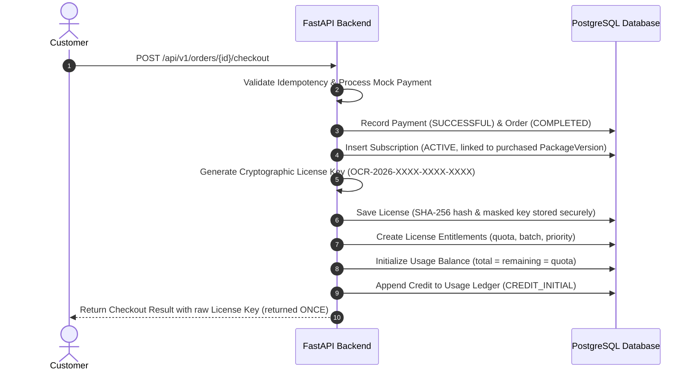

# ocrPlatform – Enterprise OCR Service Marketplace

**ocrPlatform** is a modern SaaS web application for optical character recognition (OCR) microservices. It enables individual customers to discover specialized OCR models (Invoice, Identity/eKYC, Contracts, Tables/Forms, Receipts, and General PDFs), purchase quota bundles with hybrid billing (Page, Document, Credit), receive automatically issued cryptographic API licenses, manage API keys, and monitor real-time inference telemetry.

---

## 🏛️ System Architecture

`ocrPlatform` follows a **Modular Monolith** architecture:

```
ocrPlatform/
├── backend/
│   ├── app/
│   │   ├── main.py                  # FastAPI Application Entry & Routing
│   │   ├── seed.py                  # Database Seeder (Demo Data)
│   │   ├── core/                    # Security, Database, Config, Dependencies
│   │   ├── common/                  # Models, Schemas, Enums, Utils
│   │   └── modules/                 # Modular Domain Services
│   │       ├── auth/                # JWT Auth, Registration, Refresh Tokens
│   │       ├── users/               # Customer Profile Management
│   │       ├── ocr_catalog/         # Public Marketplace & Document Types
│   │       ├── packages/            # Commercial Packages & Versioning
│   │       ├── orders/              # Orders, Mock Payments & Checkout Engine
│   │       ├── subscriptions/       # Subscriptions Management
│   │       ├── licenses/            # Cryptographic License Issuance & API Keys
│   │       ├── usage/               # Quota Balances, Ledger & Reservations
│   │       └── admin/               # Administrative Management Endpoints
│   ├── migrations/                  # Alembic Database Migrations
│   ├── tests/                       # Pytest Test Suite
│   ├── Dockerfile                   # Production Backend Docker Container
│   └── requirements.txt             # Backend Python Dependencies
├── src/                             # React + TypeScript Frontend
│   ├── app/                         # Router, Layouts, Providers
│   ├── components/                  # UI Primitives, Common Widgets, StatCards
│   ├── hooks/                       # TanStack Query Custom Hooks
│   ├── modules/                     # Customer & Admin Portal Views (18 Screens)
│   ├── services/api/                # API Client & Backend Endpoints Integration
│   └── stores/                      # Zustand Platform Store with Local Sync
├── docker-compose.yml               # PostgreSQL, Redis & FastAPI Orchestration
└── main.py                          # PyCharm & CLI Fast Starter
```

---

## 🗄️ Database Schema & Entities

The relational database is built with **PostgreSQL** (and supports SQLite for zero-dependency local test suites):

| Table | Description | Key Fields |
|---|---|---|
| `users` | User credentials & roles | `id`, `email`, `hashed_password`, `role` (CUSTOMER, PLATFORM_ADMIN), `status` |
| `user_profiles` | Extended account metadata | `user_id`, `company_name`, `phone`, `address`, `tax_id` |
| `refresh_tokens` | Secure token refresh | `token_hash`, `user_id`, `expires_at`, `revoked` |
| `ocr_services` | OCR Microservice catalog | `code`, `name`, `category`, `status` (draft, published, archived), `starting_price` |
| `document_types` | Document taxonomy | `code`, `name`, `category`, `example_image`, `status` |
| `service_document_types` | Many-to-many associations | `service_id`, `document_type_id` |
| `packages` | Commercial bundles | `code`, `name`, `tier`, `service_id`, `status` |
| `package_versions` | Immutable package snapshots | `package_id`, `version_number`, `price`, `quota_type` (Page, Document, Credit), `quota_amount`, `is_current` |
| `credit_rates` | Credit conversion per OCR task | `operation_type`, `credits_per_unit`, `description` |
| `orders` | Customer checkout orders | `order_number`, `user_id`, `package_version_id`, `amount`, `status`, `idempotency_key` |
| `payments` | Settlement transactions | `payment_number`, `order_id`, `user_id`, `method`, `status`, `transaction_reference` |
| `subscriptions` | Active service subscriptions | `user_id`, `package_version_id`, `order_id`, `service_id`, `start_date`, `end_date`, `status` |
| `licenses` | Cryptographic license records | `key_hash` (SHA-256), `masked_key`, `user_id`, `subscription_id`, `status`, `expires_at` |
| `license_entitlements` | Quota & capability limits | `license_id`, `quota_type`, `initial_quota`, `api_access`, `batch_processing`, `priority_processing` |
| `api_credentials` | Developer API Keys | `name`, `key_prefix`, `secret_hash`, `license_id`, `user_id`, `status` (active, revoked) |
| `usage_balances` | Real-time quota balance | `license_id`, `user_id`, `quota_type`, `total_quota`, `used_quota`, `remaining_quota` |
| `usage_ledger` | Append-only audit ledger | `license_id`, `delta`, `balance_after`, `entry_type`, `reference_type`, `reference_id` |

---

## ⚡ Automatic License Issuance Flow

When an order checkout succeeds, the backend transaction executes the following sequence:



> [!IMPORTANT]
> The full cryptographic license key is returned **strictly once** at checkout/issuance time. In all regular list and detail APIs, only the secure `masked_key` (e.g. `OCR-2026-****-****-ABCD`) is displayed to protect customer credentials.

---

## 🌐 API Endpoints Reference (`/api/v1`)

### Authentication & Users
- `POST /api/v1/auth/register` - Create customer account
- `POST /api/v1/auth/login` - Obtain JWT access & refresh token pair
- `POST /api/v1/auth/refresh` - Refresh access token
- `POST /api/v1/auth/logout` - Invalidate active session
- `GET /api/v1/users/me` - Get current user profile
- `PUT /api/v1/users/me/profile` - Update customer profile

### OCR Marketplace & Catalog
- `GET /api/v1/ocr-services` - List published OCR microservices (Public)
- `GET /api/v1/ocr-services/{id}` - Service details with document types
- `GET /api/v1/ocr-services/{id}/packages` - Available package tiers for a service
- `GET /api/v1/document-types` - List active document taxonomy types
- `GET /api/v1/packages/{id}` - Get package snapshot
- `GET /api/v1/credit-rates` - Credit conversion rates for operations

### Orders & Payments
- `POST /api/v1/orders` - Create new purchase order
- `GET /api/v1/orders` - List current customer's purchase orders
- `GET /api/v1/orders/{id}` - Get order details (ownership protected)
- `POST /api/v1/orders/{id}/checkout` - Execute payment & trigger automatic license issuance
- `GET /api/v1/payments/history` - List payment receipts

### Subscriptions & Licenses
- `GET /api/v1/subscriptions` - List customer active subscriptions
- `GET /api/v1/subscriptions/{id}` - Get subscription details
- `GET /api/v1/licenses` - List customer licenses (masked keys)
- `GET /api/v1/licenses/{id}` - License details and audit event timeline
- `POST /api/v1/licenses/activate` - Activate license via raw key
- `POST /api/v1/licenses/{id}/credentials` - Create API key (returns raw key once)
- `GET /api/v1/licenses/{id}/credentials` - List API credentials for license
- `DELETE /api/v1/licenses/{id}/credentials/{credential_id}` - Revoke API credential

### Usage & Telemetry
- `GET /api/v1/usage/summary` - Aggregate quota summary & per-license balances
- `GET /api/v1/usage/history` - Historical usage consumption log

### Platform Administration (`PLATFORM_ADMIN` required)
- `GET /api/v1/admin/ocr-services` - List all services (draft, published, archived)
- `POST /api/v1/admin/ocr-services` - Create new OCR service
- `PUT /api/v1/admin/ocr-services/{id}` - Update OCR service details
- `POST /api/v1/admin/ocr-services/{id}/publish` - Publish/unpublish service
- `GET /api/v1/admin/document-types` - List document types
- `POST /api/v1/admin/document-types` - Create document type
- `PUT /api/v1/admin/document-types/{id}` - Edit document type
- `GET /api/v1/admin/packages` - List all platform packages
- `POST /api/v1/admin/packages` - Create package with initial version
- `PUT /api/v1/admin/packages/{id}` - Edit package metadata
- `POST /api/v1/admin/packages/{id}/versions` - Publish new immutable package version
- `POST /api/v1/admin/packages/{id}/activate` - Toggle package active status
- `GET /api/v1/admin/licenses` - Inspect all platform licenses
- `POST /api/v1/admin/licenses/generate` - Issue complimentary license
- `GET /api/v1/admin/customers` - List registered customer accounts

---

## 🔑 Demo Seed Accounts

The database comes pre-seeded with realistic data:

| Role | Email | Password | Details |
|---|---|---|---|
| **Platform Admin** | `admin@ocrplatform.com` | `Admin@123456` | Full platform admin console access |
| **Customer 1** | `alex@techcorp.io` | `Customer@123456` | Active PDF Pro Subscription & License |
| **Customer 2** | `sarah@fintech.com` | `Customer@123456` | Individual customer account |

---

## 🚀 Running the Project

### Option A: Local Development (Conda + Vite)

#### 1. Start FastAPI Backend:
```bash
# In project root:
python main.py
# Backend runs at http://127.0.0.1:8000
# OpenAPI Docs at http://127.0.0.1:8000/api/v1/docs
```

#### 2. Start Frontend Dev Server:
```bash
npm run dev
# Frontend runs at http://localhost:3000
```

### Option B: Docker Compose (Full Stack)
```bash
docker compose up --build
```
This launches:
- **PostgreSQL 16**: Port `5432`
- **Redis 7**: Port `6379`
- **FastAPI Backend**: Port `8000` (auto-runs migrations and seeds database)

---

## 🧪 Running the Test Suite

The backend test suite is powered by `pytest` and uses in-memory SQLite isolation:

```bash
cd backend
python -m pytest -v
```

All 19 test scenarios covering:
- Authentication & Duplicate Email validation
- Public Marketplace vs. Draft service isolation
- Package creation & immutable Versioning
- Orders, Payment failure simulation & Idempotent Checkout
- Automatic License Issuance & Entitlement provisioning
- API Credential generation & Revocation
- Cross-customer Ownership & RBAC protection
