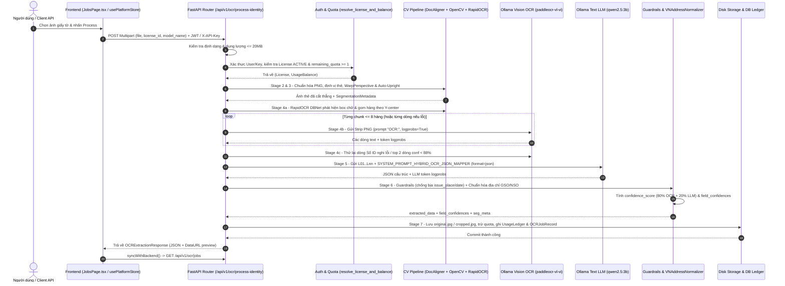
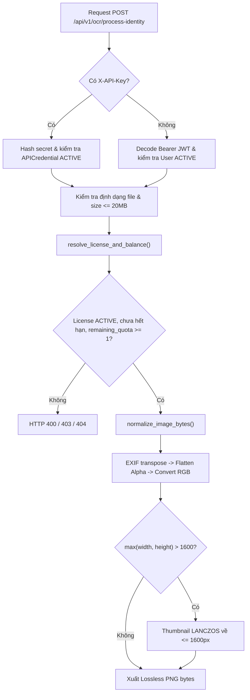
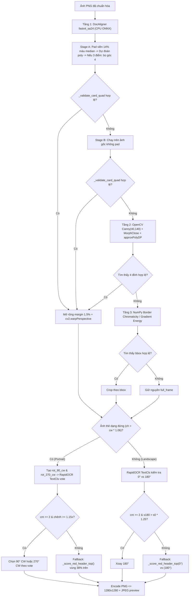
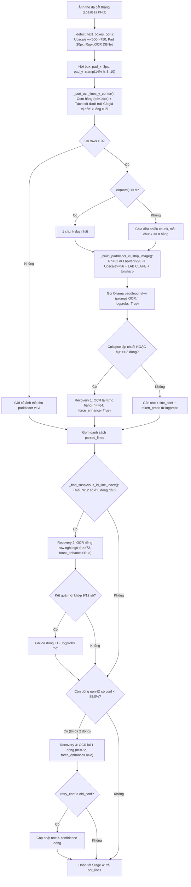
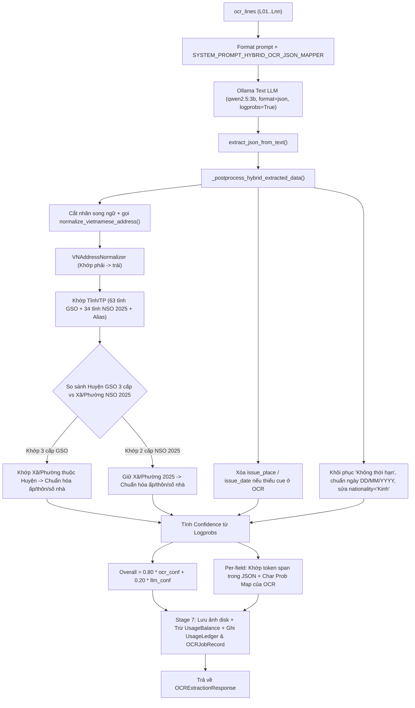

# Tài liệu Kiến trúc & Logic OCR Engine (`hybrid_paddle_vl`)

> **Phạm vi tài liệu:** Kiểm tra (audit) toàn bộ luồng xử lý OCR hiện tại của **ocrPlatform** (Frontend + FastAPI Backend + Computer Vision + Ollama `paddleocr-vl-vi` & `qwen2.5:3b` + Hậu xử lý địa giới hành chính Việt Nam) và vẽ sơ đồ kiến trúc/thuật toán chi tiết.
>
> **Trạng thái mã nguồn kiểm tra:** Commit `0ef4c02` (`HEAD -> master`). Pipeline cũ (`VietOCR`, `Pure VLM`) đã được loại bỏ hoàn toàn; hệ thống hiện chạy duy nhất kiến trúc **`hybrid_paddle_vl`**.

---

## 1. Tổng quan Kiến trúc End-to-End

Kiến trúc hiện tại tách bạch **3 tầng xử lý chính**:
1. **CV Pre-processing (CPU):** Chuẩn hóa ảnh, định vị thẻ & nắn phẳng phối cảnh (`DocAligner fastvit_sa24` -> `OpenCV Canny` -> `NumPy Contrast/Gradient`), tự động xoay thẳng chiều đọc (`RapidOCR TextDet + TextCls` -> `Red Header Heuristic`).
2. **Visual Text Recognition (CPU Det + GPU VLM):** Phát hiện vùng chữ (`RapidOCR DBNet`), gom hàng & tách cột góc dưới trái (`_sort_ocr_lines_y_center`), ghép strip tăng cường nét (`CLAHE + Unsharp Mask`), nhận diện dòng chữ tiếng Việt qua **`paddleocr-vl-vi`** (Ollama GPU) kèm **vòng lặp phục hồi 3 tầng**.
3. **Structured Mapping, Hậu xử lý & Tính điểm tin cậy:** Chuyển danh sách dòng text sang JSON chuẩn bằng Text-only LLM (**`qwen2.5:3b`**), áp dụng guardrail chống bịa dữ liệu, chuẩn hóa địa danh 2 bộ dữ liệu **GSO 63 tỉnh 3 cấp** & **NSO 34 tỉnh 2 cấp 2025**, chấm điểm tin cậy từ token `logprobs` thực (`80% OCR + 20% LLM`), lưu ảnh ra đĩa và trừ quota nguyên tử.

---

## 2. Sơ đồ chi tiết từng Giai đoạn (Pipeline Stages)

### 2.1. Giai đoạn 1 & 2: Xác thực, Kiểm tra Quota & Chuẩn hóa ảnh đầu vào

- **Router (`backend/app/modules/ocr_engine/router.py`):**
  - Hỗ trợ 2 cơ chế xác thực qua `get_auth_context`: Header `X-API-Key` (băm `hash_secret` đối chiếu `APICredential.status == ACTIVE`) hoặc `Bearer JWT` (`type == "access"`), đồng thời kiểm tra `User.status == ACTIVE`.
  - Giới hạn phần mở rộng `.png, .jpg, .jpeg, .webp, .pdf` và kích thước tối đa `20 MB`.
- **License & Balance (`resolve_license_and_balance`):**
  - Ưu tiên lấy License gắn với `APICredential`, nếu dùng JWT thì tìm theo `license_id` (đúng `user_id`) hoặc tự lấy License `ACTIVE` đầu tiên của User.
  - Bắt buộc `lic.status == ACTIVE`, `lic.expires_at >= utc_now()`, có `UsageBalance` và `remaining_quota >= 1`.
- **Chuẩn hóa ảnh (`normalize_image_bytes`):**
  - Dùng `PIL.ImageOps.exif_transpose` sửa hướng ảnh từ EXIF camera điện thoại.
  - Trộn nền trắng nếu ảnh có kênh alpha (`RGBA`, `LA`, `P` có transparency) -> chuyển về `RGB`.
  - Thu nhỏ nếu `max(width, height) > 1600` (`LANCZOS`) -> xuất PNG không mất dữ liệu (`lossless PNG`).

---

### 2.2. Giai đoạn 3: Định vị thẻ (3 tầng Fallback), Nắn phẳng & Xoay thẳng chiều đọc

Hàm `preprocess_identity_document_cv` chịu trách nhiệm tách giấy tờ khỏi nền (bàn gỗ, đá hoa cương, tay cầm, ảnh chụp nghiêng) và xoay đúng chiều ngang đọc từ trái sang phải.

1. **Tầng 1 — `_detect_card_docaligner_warp` (Chính):**
   - Lazy-load singleton `DocAligner(model_type=ModelType.heatmap, model_cfg="fastvit_sa24")` chạy CPU ONNX.
   - **Stage A:** Thêm viền `pad = max(16, int(max(h, w) * 0.14))` bằng màu median của biên ảnh (giúp nhận đủ 4 góc kể cả khi thẻ chạm sát mép ảnh). Nếu model trả 3 góc -> dựng góc thứ 4 bằng phép hình bình hành (`_complete_4th_corner`).
   - **Stage B:** Nếu Stage A trượt kiểm tra hình học -> chạy lại trên ảnh gốc không padding.
   - **Kiểm tra hình học (`_validate_card_quad`):** Đa giác lồi, `area_ratio` trong `[0.06, 0.99]`, cạnh nhỏ nhất `>= max(20px, 0.08 * min(w, h))`, tỷ lệ khung hình `aspect` trong `[1.12, 2.40]`.
   - Mở rộng vùng chọn thêm `1.5%` ra ngoài tâm (`_expand_quad_points`) để tránh cắt mất chữ sát mép thẻ -> `cv2.warpPerspective` (`INTER_CUBIC`).
2. **Tầng 2 — `_detect_card_contour_opencv` (Fallback 1):**
   - `Gray` -> `GaussianBlur(5x5)` -> `Canny(40, 140)` -> `Morphology CLOSE (5x5)` -> duyệt top 6 contour lớn nhất -> `approxPolyDP(0.025 * peri)` tìm tứ giác 4 đỉnh thỏa `_validate_card_quad` -> `warpPerspective`.
3. **Tầng 3 — `_detect_card_bbox_cv` (Fallback 2):**
   - **Contrast RGB & Chromaticity `(R-G, G-B)`:** So với median + std viền ngoài 4 cạnh (kháng nhiễu sáng tối mặt bàn đá hoa cương).
   - **Gradient Energy:** Nếu không tách được màu nền, dùng đạo hàm biên `|dx| + |dy|` ngưỡng `percentile 85`.
   - Nếu vẫn thất bại -> giữ nguyên `full_frame`.
4. **Xoay thẳng chiều đọc (`_auto_upright_cropped_card`):**
   - **Nếu ảnh đứng (`ch > cw * 1.06`):** Thử xoay `90° CW` và `270° CW`. Chạy `_detect_text_orientation_vote` bằng `RapidOCR TextDet + TextCls` trên bản `rot_90_cw` (bỏ box ngắn/dọc, chỉ lấy `conf >= 0.55`, trọng số `conf * sqrt(width)`). Nếu `valid_count >= 2` và chênh lệch `>= 1.15x` -> chọn góc tương ứng; nếu không đủ box text -> fallback `_score_red_header_top` (đo mật độ màu đỏ Quốc huy & tiêu đề đỏ ở `38%` phía trên thẻ).
   - **Nếu ảnh ngang:** Kiểm tra bị lộn ngược `180°` bằng `_detect_text_orientation_vote` (yêu cầu `s180 > s0 * 1.25`), fallback `_score_red_header_top`.
5. **Đóng gói ảnh đầu vào VLM:** Nếu `cv_cropped`, thu gọn theo giới hạn `1280 x 1280` (`VLM_CROPPED_MAX_WIDTH`, `VLM_CROPPED_MAX_HEIGHT`) dạng Lossless PNG.

---

### 2.3. Giai đoạn 4: Text Detection, Sắp xếp bố cục 2 cột & Nhận diện PaddleOCR-VL 1.6 Vi

Đây là phần cốt lõi vừa được tối ưu sâu trong `service.py` để xử lý CCCD, CMND cũ, ảnh mờ và tránh lỗi lặp chuỗi của VLM:

1. **Phát hiện vùng chữ (`_detect_text_boxes_bgr`):**
   - Nếu bề rộng thẻ `< 500px` -> phóng to (`INTER_CUBIC`) lên `750px`.
   - Đệm viền `20px` màu median -> chạy `RapidOCR DBNet` (`det_thresh=0.25`, `det_box_thresh=0.40`, `det_unclip_ratio=1.55`).
   - Nới rộng box: `pad_x = 3px`, `pad_y = clamp(round(0.14 * box_h), 5, 10)` để không cắt mất dấu thanh (`hỏi, ngã, nặng`) và dấu mũ tiếng Việt.
2. **Sắp xếp dòng & Xử lý cột góc dưới trái (`_sort_ocr_lines_y_center`):**
   - Nhận diện bố cục **2 cột có ảnh chân dung** (CCCD/CMND/GPLX): khi có ít nhất 4 box nằm ở cột phải (`0.23w <= x1 <= 0.45w`), những box nằm gọn ở góc dưới trái (`x1 <= 0.16w`, `x2 <= 0.28w`, `yc > 0.50h`) và không có box kế cận sát bên phải (`gap < 0.05w`) sẽ được tách thành **`left_sidebar_items`**.
   - Các dòng cột chính được gom hàng (`row_tolerance_px = 14px`) trước, rồi nối **`left_sidebar_items`** xuống cuối -> Ngăn triệt để việc `"Có giá trị đến: ..."` bị ghép nối vào giữa dòng `"Nơi thường trú"`.
3. **Chia chunk & Dựng ảnh Strip tăng cường (`_build_paddleocr_vl_strip_image`):**
   - Nếu tổng số hàng `<= 9`: gộp vào **1 strip** duy nhất (giảm số lần gọi Ollama).
   - Nếu `> 9` hàng: chia đều thành nhiều chunk sao cho mỗi chunk tối đa **`<= 8` hàng** (tránh VLM decoding collapse / quên dòng).
   - Trên từng hàng (`_build_paddleocr_vl_row_canvas`): nối các box trái-sang-phải với `gap_x = 14px`. Nếu chiều cao gốc `rh < 32px` hoặc độ nét `Laplacian variance < 220.0` (ảnh mờ/nhỏ): phóng to lên tối thiểu `56px` và chạy **`_enhance_row_for_ocr`** (chuyển hệ màu LAB, cân bằng sáng cục bộ `CLAHE` pha trộn 70/30, rồi làm nét `Gaussian Unsharp Mask`).
   - Xếp dọc các hàng lên nền trắng tinh (`margin=16px`, `gap_y=12px`).
4. **Nhận diện qua Ollama `paddleocr-vl-vi` (`_call_paddleocr_vl_ollama`):**
   - Gửi Lossless PNG với prompt chuẩn `"OCR:"`, decoding tất định (`temperature=0.0`, `top_k=1`, `repeat_penalty=1.08`, `num_ctx=4096`, `num_predict=256`, `logprobs=True`).
   - Nếu `rows` rỗng (DBNet không tìm thấy box) -> gửi nguyên ảnh thẻ `img_bgr` cho `paddleocr-vl-vi`.
5. **Vòng lặp phục hồi 3 tầng (3-Tier Recovery Loop):**
   - **Tầng 1 — Chống sập/lặp chuỗi theo chunk (`collapsed`):** Nếu `_has_ocr_repetition_collapse(c_lines)` phát hiện cụm từ lặp `>= 4` lần / độ đa dạng từ `< 0.45` trên dòng dài `>= 60` ký tự, HOẶC số dòng trả về bị hụt `>= 3` dòng (khi chunk `>= 4` hàng) -> tự động chuyển sang **OCR từng hàng đơn lẻ** (`_ocr_single_row_paddleocr_vl`, `force_enhance=True`, `min_row_height >= 64`).
   - **Tầng 2 — Cứu dòng Số CCCD/CMND (`_find_suspicious_id_line_index`):** Quét 6 dòng đầu; nếu chưa có chuỗi đúng 9 hoặc 12 chữ số mà thấy từ khóa `Số / No.` hoặc dãy số bị gãy (như `3520228/6` do dấu đỏ đè lên) -> lấy row tương ứng ở băng tần `18%..48%` chiều cao thẻ, phóng to `>= 72px` + enhance mạnh + OCR riêng dòng đó (`num_predict=64`). Chỉ thay thế nếu kết quả mới có đúng 9 hoặc 12 chữ số.
   - **Tầng 3 — Thử lại tối đa 2 dòng non-ID có điểm tin cậy thấp (`< 88.0%`):** Sắp xếp các dòng có mean logprob `< 88.0%` từ thấp đến cao, OCR lại tối đa 2 dòng ở độ phân giải `>= 72px` + `force_enhance=True`, chỉ cập nhật nếu `retry_conf > old_conf`.

---

### 2.4. Giai đoạn 5, 6 & 7: Text LLM JSON Mapping, Hậu xử lý, Tính Confidence & Lưu trữ

1. **Text-only LLM JSON Mapping (`qwen2.5:3b`):**
   - Định dạng `ocr_lines` thành `L01: <text>`, `L02: <text>`...
   - Gọi Ollama `/api/chat` với `SYSTEM_PROMPT_HYBRID_OCR_JSON_MAPPER`, `format="json"`, `temperature=0.0`, `num_ctx <= 2048`, `num_predict <= 768`, `logprobs=True`.
   - Hỗ trợ 3 schema tài liệu (`id_card`, `passport`, `driver_license`) trong `backend/app/common/schemas/ocr_engine.py`.
2. **Guardrails Hậu xử lý (`_postprocess_hybrid_extracted_data`):**
   - Chống bịa `issue_place` / `issue_date` trên mặt trước CCCD/CMND: nếu raw OCR không chứa từ khóa (`"nơi cấp"`, `"cục cảnh sát"`, `"ngày cấp"`, `"date of issue"`...) -> ép về `null`.
   - Khôi phục `expiry_date = "Không thời hạn"` nếu text chứa `"không thời"` / `"vô thời hạn"`.
   - Chuyển ngược ngày `YYYY-MM-DD` về đúng `DD/MM/YYYY` hoặc `DD-MM-YYYY` nếu khớp chuỗi trong raw OCR.
   - Chống nhầm `"Dân tộc: Kinh"` thành `nationality = "Kinh"`: nếu thấy `"dân tộc"` -> đổi về `"Việt Nam"` (nếu có) hoặc `null`.
   - Cắt bỏ các tiền tố nhãn tiếng Việt / song ngữ bám đầu `origin_address` & `residence_address`.
3. **Chuẩn hóa địa chỉ hành chính Việt Nam (`normalize_vietnamese_address` trong `vn_address_normalizer.py`):**
   - Load đồng thời 2 bộ danh mục chính thức:
     - **Legacy 63 tỉnh, 3 cấp (Tỉnh -> Huyện -> Xã):** `backend/app/modules/ocr_engine/data/gso_legacy_2025_01_04.csv` (10.057 dòng).
     - **Cải cách 2025 — 34 tỉnh, 2 cấp (Tỉnh -> Xã/Phường/Đặc khu):** `backend/app/modules/ocr_engine/data/nested_divisions_2025.json` (23.555 dòng).
   - Khớp **từ phải sang trái** (Tỉnh/TP -> Huyện cũ hoặc Xã 2025 -> Xã cũ): hỗ trợ alias (`HCM`, `BR-VT`, `Đắc Lắc`...), khớp chính xác có dấu -> không dấu -> fuzzy `difflib` có kiểm soát (`0.82–0.87`), giữ nguyên phong cách viết tắt/có tiền tố nếu hợp lệ, đồng thời sửa dấu lỗi OCR ở phần tiền tố cấp dưới xã (`Ap 4 -> Ấp 4`, `Thon -> Thôn`, `Xom -> Xóm`, `To 5 -> Tổ 5`...) mà vẫn bảo vệ tên đường/tên riêng.
4. **Tính điểm tin cậy (`confidence_score` & `field_confidences`):**
   - `ocr_confidence`: trung bình có trọng số theo `token_count` của từng dòng PaddleOCR-VL.
   - `llm_confidence`: trung bình xác suất token `exp(logprob) * 100` từ JSON output của Text LLM.
   - **Tổng thể:** `0.80 * ocr_confidence + 0.20 * llm_confidence` (`confidence_source = "model_logprobs"`). Nếu parse JSON lỗi hoặc không có text -> `0.0`.
   - **Từng trường (`field_confidences`):** `_extract_llm_field_confidences` parse vị trí span giá trị từng key trong JSON logprobs; `_match_value_ocr_confidence` tìm lại giá trị đó (cả có dấu lẫn không dấu, chia nhỏ theo dấu phẩy/từ) trên `_build_ocr_char_prob_map`; ghép công thức `0.80 * ocr_f + 0.20 * llm_f`.
5. **Lưu trữ & Trừ Quota (Stage 7):**
   - Ghi `original.jpg` và `cropped.jpg` vào `storage/ocr_jobs/{job_id}/`, sinh `image_access_token` (`secrets.token_urlsafe(24)`).
   - Cập nhật `UsageBalance` (`used_quota += 1`), thêm `UsageRecord`, `UsageLedger` (`DEBIT_USAGE`, `delta = -1`), và `OCRJobRecord`, cập nhật `APICredential.last_used_at`, commit DB.

---

## 3. Kết quả Kiểm tra (Audit) Logic Hiện tại: Lỗi & Điểm cần lưu ý

Khi kiểm tra thực tế mã nguồn và chạy kiểm thử (`pytest tests/test_ocr_engine.py -q`), ghi nhận các vấn đề sau:

| Mức độ | Thành phần / Vị trí | Mô tả chi tiết vấn đề | Ảnh hưởng thực tế |
| :--- | :--- | :--- | :--- |
| **CRITICAL (Blocker)** | `backend/app/common/models/__init__.py` (dòng 10) `backend/app/modules/ocr_engine/service.py` (dòng 46) | Cả hai file đều import `from app.common.models.ocr_jobs import OCRJobRecord`, nhưng **file `backend/app/common/models/ocr_jobs.py` không tồn tại trên đĩa** (dù bảng `ocr_jobs` đã có trong `ocrplatform.db`). | Chạy `pytest tests/test_ocr_engine.py` báo lỗi ngay từ lúc thu thập test: `ModuleNotFoundError: No module named 'app.common.models.ocr_jobs'`. Backend app cũng không thể khởi động nếu chưa khôi phục file model này. |
| **MEDIUM** | `backend/app/modules/ocr_engine/router.py` (dòng 113–114) `src/modules/customer/jobs/JobsPage.tsx` | Router và UI đều cho phép tải lên file `.pdf` (`application/pdf`), nhưng `normalize_image_bytes()` chỉ dùng `PIL.Image.open()` mà **không có bước chuyển đổi PDF sang ảnh** (PyMuPDF / pdf2image). | Nếu người dùng upload file PDF thật, `normalize_image_bytes` bắt `Exception` và trả nguyên raw PDF bytes -> `preprocess_identity_document_cv` rơi vào nhánh `fallback`, rồi `_detect_text_boxes_bgr` ném lỗi không đọc được ảnh. |
| **MINOR** | `src/modules/customer/jobs/JobsPage.tsx` (dòng 175–178) `backend/app/core/config.py` (dòng 35) | Frontend lọc `available_models` theo `m.mode === 'hybrid'` nên model `paddleocr-vl-vi` (`mode="hybrid_paddle_vl"`) không hiện trong dropdown; `config.py` vẫn còn biến cũ `OLLAMA_MODEL` song song `OLLAMA_TEXT_MODEL`; `JobsPage.tsx` giữ nhánh fallback mock khi submit không chọn file (dòng 304–326) và nút `retryJob` chỉ cập nhật trạng thái cục bộ trong Zustand (`confidenceScore: 98.8`). | Dễ gây nhầm lẫn khi bảo trì UI/cấu hình; nút Retry trên UI chưa gọi lại API `/ocr/process-identity`. |

---

## 4. Tham chiếu Nhanh Cấu hình & File Liên quan

- **Cấu hình OCR chính (`backend/app/core/config.py`):**
  - `OCR_PIPELINE_MODE = "hybrid_paddle_vl"`
  - `OLLAMA_BASE_URL = "http://127.0.0.1:11434"` (tự chuẩn hóa `localhost -> 127.0.0.1` tránh trễ IPv6 trên Windows)
  - `PADDLEOCR_VL_MODEL = "paddleocr-vl-vi"`, `PADDLEOCR_VL_STRIP_MIN_ROW_HEIGHT = 48`
  - `OLLAMA_TEXT_MODEL = "qwen2.5:3b"`, `OLLAMA_NUM_CTX = 4096`, `OLLAMA_NUM_PREDICT = 1024`, `OLLAMA_TIMEOUT_SECONDS = 240`
  - `DOCALIGNER_ENABLED = True`, `DOCALIGNER_MODEL_CFG = "fastvit_sa24"`
  - `RAPIDOCR_DET_THRESH = 0.25`, `RAPIDOCR_DET_BOX_THRESH = 0.40`, `RAPIDOCR_DET_UNCLIP_RATIO = 1.55`
  - `VLM_MAX_IMAGE_DIMENSION = 1280`, `VLM_CROPPED_MAX_WIDTH = 1280`, `VLM_CROPPED_MAX_HEIGHT = 1280`
- **Các file cốt lõi:**
  - `backend/app/modules/ocr_engine/router.py` — API endpoints (`/ocr/health`, `/ocr/process-identity`, `/ocr/jobs`, `/ocr/jobs/{job_id}/image/{kind}`).
  - `backend/app/modules/ocr_engine/service.py` — Toàn bộ CV pipeline, RapidOCR + PaddleOCR-VL 3-tier recovery, Ollama JSON mapping, Confidence scoring, Persistence & Quota.
  - `backend/app/modules/ocr_engine/prompts.py` — `SYSTEM_PROMPT_HYBRID_OCR_JSON_MAPPER`.
  - `backend/app/modules/ocr_engine/vn_address_normalizer.py` — Chuẩn hóa địa danh song song GSO 63 tỉnh & NSO 2025 34 tỉnh.
  - `backend/app/common/schemas/ocr_engine.py` — Schemas cho IDCard/Passport/DriverLicense, `SegmentationMetadata`, `OCRExtractionResponse`, `OCRJobHistoryItem`, `VLMHealthResponse`.
  - `src/modules/customer/jobs/JobsPage.tsx` & `src/stores/usePlatformStore.ts` — Giao diện upload/hiển thị kết quả và đồng bộ lịch sử job.
